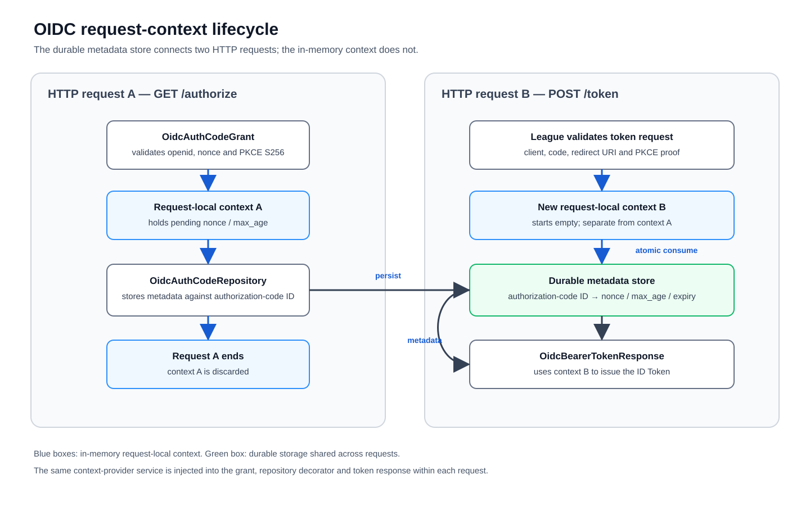

# Integration Guide

This guide describes how a PHP application wires the existing DarkSide OpenID Connect Server components into League OAuth2 Server. For complete runnable applications with separate application-owned adapters, see [darkside/openid-connect-server-examples](https://github.com/darkside666/openid-connect-server-examples). They do not add protocol capabilities or provide a production application. Application-specific repositories, login, consent, persistence, routing and security controls must be supplied by the host application.

## 1. Understand the boundary

The library adds OpenID Connect behavior to an application-owned League OAuth2 Server setup. It expects the host application to provide:

- League client, scope, access-token, authorization-code and refresh-token repositories.
- An `IdentityResolverInterface` implementation that resolves an authenticated end-user identifier.
- An `AuthorizationCodeMetadataStoreInterface` implementation with atomic one-time consumption.
- RSA OAuth signing/encryption configuration for League, separate from the OIDC RS256 signing key.
- HTTPS routes for discovery, authorization, token, JWKS and (if advertised) UserInfo.
- Authentication, session, client registration and consent behavior.

The OIDC grant adapter does not authenticate users or decide whether consent should be granted.

## 2. Install and import the components

```bash
composer require darkside/openid-connect-server
```

The examples below use these classes:

```php
use DateInterval;
use League\OAuth2\Server\AuthorizationServer;
use League\OAuth2\Server\ResourceServer;
use DarkSide\OpenIdConnectServer\Discovery\DiscoveryDocumentGenerator;
use DarkSide\OpenIdConnectServer\Discovery\ProviderMetadata;
use DarkSide\OpenIdConnectServer\Endpoint\UserInfoEndpoint;
use DarkSide\OpenIdConnectServer\Identity\IdentityInterface;
use DarkSide\OpenIdConnectServer\Identity\IdentityResolverInterface;
use DarkSide\OpenIdConnectServer\Jwks\JwksGenerator;
use DarkSide\OpenIdConnectServer\Key\SigningKey;
use DarkSide\OpenIdConnectServer\Key\SigningKeySet;
use DarkSide\OpenIdConnectServer\League\OidcAuthCodeGrant;
use DarkSide\OpenIdConnectServer\League\OidcAuthCodeRepository;
use DarkSide\OpenIdConnectServer\League\OidcBearerTokenResponse;
use DarkSide\OpenIdConnectServer\Token\IdTokenIssuer;
use DarkSide\OpenIdConnectServer\Transaction\OidcRequestContext;
use DarkSide\OpenIdConnectServer\Transaction\RequestScopedOidcContextProvider;
```

## 3. Configure the OIDC signing key and issuer

The OIDC signing key is an RSA key pair used to sign ID Tokens. It is separate from the OAuth signing key used by League to sign access tokens, and separate from League's encryption key.

Load the key material from a secret-managed location outside the public web root. Do not generate keys on each request and do not commit private keys to source control.

```php
$issuerIdentifier = 'https://identity.example.test';
$keyId = 'oidc-rs256-2026-01';

$privateKeyPem = file_get_contents('/secure/keys/oidc-private.pem');
$publicKeyPem = file_get_contents('/secure/keys/oidc-public.pem');

if (!is_string($privateKeyPem) || !is_string($publicKeyPem)) {
    throw new RuntimeException('Unable to load the OIDC signing key pair.');
}

$activeOidcSigningKey = new SigningKey($keyId, $privateKeyPem, $publicKeyPem);
$idTokenIssuer = new IdTokenIssuer($issuerIdentifier, $activeOidcSigningKey, 300);

// Initially, the active key is also the only key published in JWKS.
$oidcSigningKeySet = new SigningKeySet($activeOidcSigningKey);
$jwksGenerator = new JwksGenerator($oidcSigningKeySet);
```

`SigningKey` checks that the private and public PEM values are matching RSA keys and that the key size is at least 2048 bits. Its `keyId` is emitted as the ID Token JOSE `kid` and the JWKS `kid`.

### Keep issuer and key configuration consistent

The issuer passed to `IdTokenIssuer` must be exactly the same issuer configured in `ProviderMetadata`. The active `SigningKey` passed to `IdTokenIssuer` must also be the active key in the `SigningKeySet` passed to `JwksGenerator`.

Configure these values from one application configuration source rather than duplicating literal values in unrelated service definitions. The library accepts the objects you provide; it does not coordinate mismatched configuration automatically. For the distinction between OAuth signing/encryption material and OIDC ID Token keys, private-key loading limitations, and a staged rotation procedure, see [Signing-Key Configuration and Operations Review](SIGNING-KEY-CONFIGURATION.md).

## 4. Implement identity resolution

For the full subject, claim-disclosure, account-lifecycle and `auth_time` checklist, see [the persistence and identity integration review](PERSISTENCE-AND-IDENTITY-REVIEW.md).

The host application owns the relationship between its user records and OIDC identities. `IdentityResolverInterface::resolve()` receives:

- The authenticated resource-owner identifier stored in League's access token.
- The OAuth client identifier.
- The scopes actually granted to that access token.

It must return an `IdentityInterface`. The `subject()` value must be stable and unique within this issuer. Do not use an email address or a sequential database ID as the OIDC subject. If your application has an immutable, opaque external identity key, map that to the OIDC subject.

A simplified example:

```php
use DarkSide\OpenIdConnectServer\Identity\ArrayIdentity;
use DarkSide\OpenIdConnectServer\Identity\IdentityInterface;
use DarkSide\OpenIdConnectServer\Identity\IdentityResolverInterface;

final readonly class ApplicationIdentityResolver implements IdentityResolverInterface
{
    public function __construct(private UserRepository $users)
    {
    }

    public function resolve(string $userIdentifier, string $clientId, array $grantedScopes): IdentityInterface
    {
        $user = $this->users->findById($userIdentifier);
        if ($user === null || !$user->isActive()) {
            throw new RuntimeException('The authenticated user is no longer available.');
        }

        // Apply both granted-scope filtering and your client-specific disclosure policy.
        $claims = [];
        if (in_array('profile', $grantedScopes, true)
            && $this->users->clientMayReceiveProfile($clientId, $user)) {
            $claims['name'] = $user->displayName();
            $claims['preferred_username'] = $user->publicUsername();
        }
        if (in_array('email', $grantedScopes, true)
            && $this->users->clientMayReceiveEmail($clientId, $user)) {
            $claims['email'] = $user->email();
            $claims['email_verified'] = $user->emailIsVerified();
        }

        return new ArrayIdentity(
            $user->oidcSubject(), // Stable, opaque, issuer-scoped identifier.
            $claims,
            $user->lastAuthenticationTime(),
        );
    }
}
```

`UserRepository` and the methods in this example are illustrative application APIs, not classes provided by this package. Your resolver must enforce client-specific claim disclosure for application-defined claims. The library independently filters standard OIDC claims according to standard scopes and rejects identity-supplied protocol-reserved claims such as `iss`, `sub`, `aud`, `exp`, `iat` and `nonce`.

When an authorization request contains `max_age`, the host application must inspect `OidcAuthorizationRequest::maxAge()` during the authorization interaction and perform re-authentication when required **before approving the request**. The returned identity must expose the authentication time through `authTime()`. The ID Token issuer performs a fail-closed freshness check as a backstop; it does not implement login or re-authentication.

## 5. Implement nonce metadata persistence

For database/Redis implementation patterns, concurrency requirements and the reference-store limitations, see [the persistence and identity integration review](PERSISTENCE-AND-IDENTITY-REVIEW.md).

The OIDC adapter binds the authorization request's nonce (and optional `max_age`) to League's opaque authorization-code identifier. Implement `AuthorizationCodeMetadataStoreInterface` using durable storage shared by the authorization and token HTTP requests.

The contract is strict:

- `store()` must create a unique record for the authorization-code ID.
- The record must expire no later than the authorization code itself.
- `consume()` must atomically retrieve and delete the record.
- A record may be returned successfully at most once, including when two token requests race.
- Missing, expired or already-consumed records must return `null`.

A representative SQL table (adjust types and syntax for your database):

```sql
CREATE TABLE oidc_authorization_code_metadata (
    authorization_code_id VARCHAR(128) PRIMARY KEY,
    nonce VARCHAR(256) NOT NULL,
    expires_at TIMESTAMP NOT NULL,
    max_age INTEGER NULL
);
```

For databases supporting row-level locking, the essential `consume()` pattern is:

1. Begin a transaction.
2. Select the row by `authorization_code_id` using `SELECT ... FOR UPDATE`.
3. Delete the row while the lock is held.
4. Commit the transaction.
5. Return the metadata only if the row existed and had not expired; otherwise return `null`.

The unique primary key prevents duplicate metadata. The row lock and delete in the same transaction ensure that concurrent consumers cannot both receive the same nonce. Use the equivalent atomic primitive for your database if it differs; a plain `SELECT` followed by a later, uncoordinated `DELETE` is not sufficient.

`OidcAuthCodeRepository` decorates the application's League `AuthCodeRepositoryInterface`:

```php
$oidcAuthCodeRepository = new OidcAuthCodeRepository(
    $applicationAuthCodeRepository,
    $authorizationCodeMetadataStore,
    $requestContextProvider,
);
```

The decorator first asks the inner repository to persist the authorization code and then stores its OIDC metadata. If metadata storage fails, it attempts to revoke the just-created code so an unbound code is not returned. The application's League authorization-code repository must itself provide reliable, concurrency-safe revocation and redemption behavior. The code repository and metadata store are not automatically wrapped in one cross-store database transaction by this library.

## 6. Understand request-context lifetime

The same `OidcRequestContextProviderInterface` instance must be injected into all three components:

- `OidcAuthCodeGrant`
- `OidcAuthCodeRepository`
- `OidcBearerTokenResponse`

For a traditional request-per-process PHP deployment, create one provider for the current HTTP request and use it throughout that request's service graph:

```php
$requestContextProvider = new RequestScopedOidcContextProvider(new OidcRequestContext());
```

Do **not** make this concrete provider a process-wide singleton. It wraps one mutable context. If an application shares an `AuthorizationServer` and repository objects across concurrent requests (for example, in a long-running worker or coroutine server), supply an implementation of `OidcRequestContextProviderInterface` that resolves the current request/fiber-local context.

### Why the context is request-scoped

The diagram below shows the two-request lifecycle. The durable metadata store carries the authorization transaction binding from `/authorize` to `/token`; the in-memory context is newly created for each HTTP request and is never used to bridge requests.



The sequence is:

1. `GET /authorize`: `OidcAuthCodeGrant` validates `openid`, `nonce` and PKCE S256, then places the pending nonce and optional `max_age` in request-local context A.
2. The authorization-code repository stores that metadata against League's authorization-code ID in the durable metadata store.
3. Request A ends and context A is discarded. The durable record remains until it expires or is consumed.
4. `POST /token`: a new request-local context B starts empty. League validates the client, code, redirect URI and PKCE proof.
5. The repository decorator atomically consumes the durable metadata and places the nonce and optional `max_age` in context B.
6. `OidcBearerTokenResponse` reads context B to issue the ID Token. Request B then ends and context B is discarded.

The durable metadata store carries the transaction binding across the two HTTP requests. The in-memory context only passes data between components while one HTTP request is being processed.

The provider instance shared by the grant, repository decorator and token response must be the same object within the service graph for that request. Creating three separate provider objects would cause the components to see different contexts.

## 7. Wire League OAuth2 Server

The host application supplies the normal League repositories and OAuth key material. The OIDC adapter decorates the application's authorization-code repository and replaces the default bearer response with `OidcBearerTokenResponse`:

```php
$authorizationCodeTtl = new DateInterval('PT5M');
$accessTokenTtl = new DateInterval('PT10M');

$requestContextProvider = new RequestScopedOidcContextProvider(new OidcRequestContext());

$oidcAuthCodeRepository = new OidcAuthCodeRepository(
    $applicationAuthCodeRepository,
    $authorizationCodeMetadataStore,
    $requestContextProvider,
);

$oidcGrant = new OidcAuthCodeGrant(
    $oidcAuthCodeRepository,
    $applicationRefreshTokenRepository,
    $authorizationCodeTtl,
    $requestContextProvider,
);

$tokenResponse = new OidcBearerTokenResponse(
    $idTokenIssuer,
    $identityResolver,
    $requestContextProvider,
);

$authorizationServer = new AuthorizationServer(
    $clientRepository,
    $accessTokenRepository,
    $scopeRepository,
    $oauthPrivateKeyPath,
    $oauthEncryptionKey,
    $tokenResponse,
);
$authorizationServer->enableGrantType($oidcGrant, $accessTokenTtl);
```

`$applicationRefreshTokenRepository` is required by League's `AuthCodeGrant` constructor, but this OIDC adapter overrides refresh-token issuance and returns no refresh token. The package does not implement refresh-token grant support. The host application's scope repository must recognize `openid` (and any other scopes the application supports), and the relevant client must be allowed to use the authorization-code grant.

The same `$requestContextProvider` variable is deliberately passed to all three OIDC components. In a request-per-process setup, the surrounding service graph should also be created within that request. Adapt the lifecycle for your framework/worker model as described above.

## 8. Configure discovery metadata and UserInfo

Only advertise endpoints that your application actually mounts and serves over HTTPS. The library generates documents; it does not register routes or infer public URLs from request headers.

```php
$metadata = new ProviderMetadata(
    issuer: $issuerIdentifier,
    authorizationEndpoint: 'https://identity.example.test/authorize',
    tokenEndpoint: 'https://identity.example.test/token',
    jwksUri: 'https://identity.example.test/.well-known/jwks.json',
    userinfoEndpoint: 'https://identity.example.test/userinfo',
    scopes: ['openid', 'profile', 'email'],
    claims: [
        'iss', 'sub', 'aud', 'exp', 'iat', 'auth_time', 'nonce',
        'name', 'preferred_username', 'email', 'email_verified',
    ],
    tokenEndpointAuthMethods: ['client_secret_basic'],
);

$discoveryGenerator = new DiscoveryDocumentGenerator($metadata);
```

The metadata profile currently permits only the `authorization_code` grant, `code` response type, `query` response mode and PKCE `S256`. `openid` must be included in `scopes`. Required ID Token claims (`iss`, `sub`, `aud`, `exp`, `iat`) must be listed in `claims`.

If UserInfo is enabled, create it with the same access-token repository and OAuth public key used by the League resource server:

```php
$resourceServer = new ResourceServer(
    $accessTokenRepository,
    'file://' . $oauthPublicKeyPath,
);
$userInfoEndpoint = new UserInfoEndpoint($resourceServer, $identityResolver);
```

The same `IdentityResolverInterface` implementation is used for ID Token and UserInfo identity resolution so that the `sub` remains consistent. UserInfo requires an access token with the `openid` scope and an end-user identifier. It accepts Bearer tokens in the Authorization header, not query parameters or form fields. The handler accepts GET and POST and returns PSR-7 responses with no-store/no-cache headers.

## 9. Mount the HTTP endpoints

The host application's router should adapt its PSR-7 request and response objects to these components. The essential handler calls are:

| Route | Handler |
|---|---|
| `GET /.well-known/openid-configuration` | Serialize `$discoveryGenerator->generate()` as JSON. |
| `GET /.well-known/jwks.json` (or configured JWKS path) | Serialize `$jwksGenerator->generate()` as JSON. |
| `GET /authorize` | Call `$authorizationServer->validateAuthorizationRequest($request)`, then run the application's login/consent interaction. |
| `POST /authorize` | Validate the application's session/CSRF/login state, set the user and approval decision on the saved authorization request, then call `completeAuthorizationRequest($authorizationRequest, $response)`. |
| `POST /token` | Call `$authorizationServer->respondToAccessTokenRequest($request, $response)`. |
| `GET` or `POST /userinfo` | Call `$userInfoEndpoint->handle($request, $response)`. |

For discovery and JWKS, JSON responses should be generated with `JSON_THROW_ON_ERROR` and an appropriate `Content-Type: application/json` header. Do not cache token or UserInfo responses. Use appropriate caching for JWKS and discovery while ensuring that key-rotation rollout and cache lifetimes are coordinated.

The authorization endpoint is an application interaction, not just a one-line library call. The host must preserve the validated authorization request safely across the login/consent interaction, protect the form with CSRF defenses, authenticate the user, enforce consent policy, and set the League authorization request's user and approval state before completing it. Do not trust a user ID, client ID, redirect URI, scope list, nonce or PKCE value copied from an unvalidated browser form.

The token endpoint must preserve League's OAuth error handling. The [reference provider](https://github.com/darkside666/openid-connect-server-examples/tree/main/reference-provider) is a concrete test-only example of endpoint wiring, with application adapters. Its login, file-backed storage and static client are not production implementations.

## 10. Signing-key rotation

For rotation, create a new `SigningKey` and use it as the active key in both `IdTokenIssuer` and `SigningKeySet`. Add the previous key as a public-only `VerificationKey` in the key set:

```php
use DarkSide\OpenIdConnectServer\Key\VerificationKey;

$newActiveKey = new SigningKey($newKeyId, $newPrivatePem, $newPublicPem);
$idTokenIssuer = new IdTokenIssuer($issuerIdentifier, $newActiveKey, 300);

$keySet = new SigningKeySet(
    $newActiveKey,
    [new VerificationKey($previousKeyId, $previousPublicPem)],
);
$jwksGenerator = new JwksGenerator($keySet);
```

Keep each retired public key published until every token signed with it has expired, including clock skew and JWKS cache/rollout overlap. Remove it only after that retention window. Never publish or retain an old private key in the JWKS. See [the key-rotation interoperability procedure](https://github.com/darkside666/openid-connect-server-examples/blob/main/docs/PHASE-6D3-KEY-ROTATION.md) for the local verification workflow.

## 11. Production-readiness responsibilities

For the detailed error-handling, logging, cache-header, health-check and deployment guidance, see [Error Handling and Operations](ERROR-HANDLING-AND-OPERATIONS.md).


This library does not replace an application security review. Before exposing an integrated provider, the host application must address at least:

- Durable, concurrency-safe authorization-code and access-token persistence/revocation.
- Atomic one-time consumption of OIDC authorization-code metadata.
- Stable subject mapping and client-/scope-specific claim disclosure.
- Login/session security, CSRF protection, consent and re-authentication for `max_age`.
- Client registration, secret storage/rotation and redirect URI governance.
- HTTPS, trusted proxy configuration and explicit public endpoint URLs.
- Private-key storage, access controls, backup, rotation and incident procedures.
- Rate limiting, audit logging, monitoring, alerting and operational ownership.
- Correct cache headers and coordinated JWKS cache/rotation windows.
- Interoperability testing against the actual deployed host application.

The repository's reference provider is a local test fixture, not a production deployment template. Passing package tests and independent RP checks does not establish OpenID Foundation conformance or certification.
